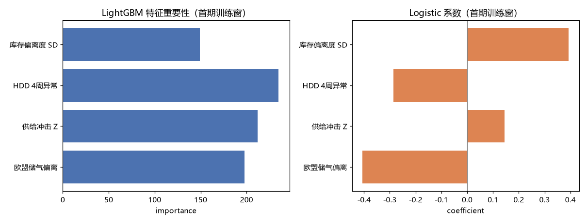

# P3 回测报告（Walk-Forward）

> 个人研究项目，输出不构成交易建议。只输出方向概率/松紧等级，不输出价格点位。

## 1. 设定
- 滚动训练窗 156 周（3 年），步长 13 周，每期外推 13 周；
- 首期训练 2019-01-04~2022-01-07，测试 2022-01-14 起；
- 末期测试 2026-07-10~2026-10-02；共 19 折、247 个 OOS 周样本。
- as-of 铁律：月频因子 shift 3 个月（13 周）；周储气 shift 1 周（周四发布）；基线只用历史年份。
- v1 权重仅在首期训练窗内 expanding 时序 CV 网格搜索，之后全程固定；v2 超参固定不调。

## 2. 整体结果（方向命中率 / AUC，标签=未来1周 HH 周均值涨跌）

| 模型 | 方向命中率 | AUC |
| --- | --- | --- |
| v1 规则压力评分 | 0.5628 | — |
| Logistic（主基线） | 0.5223 | 0.5414 |
| LightGBM（对比） | 0.5506 | 0.5417 |

注：随机/惯性双基准、分情景命中率、ROC-AUC 与失效案例复盘详见 P4 风控评估；此处仅报告方向命中率与 AUC 的 OOS 均值，不构成交易建议。

## 3. v1 权重（业务符号：SD/供给/欧盟 偏空，HDD 偏多）

`sd=0.0000  hdd=0.0000  supply=0.8000  eu=0.2000`

## 4. 特征重要性（首期训练窗）

## 5. 每折详情（walkforward_train_cutoffs.csv）

| fold | train_start | train_end(截止) | test_start | test_end | n_train | n_test |
| --- | --- | --- | --- | --- | --- | --- |
| 0 | 2019-01-04 | 2022-01-07 | 2022-01-14 | 2022-04-08 | 156 | 13 |
| 1 | 2019-04-05 | 2022-04-08 | 2022-04-15 | 2022-07-08 | 156 | 13 |
| 2 | 2019-07-05 | 2022-07-08 | 2022-07-15 | 2022-10-07 | 156 | 13 |
| 3 | 2019-10-04 | 2022-10-07 | 2022-10-14 | 2023-01-06 | 156 | 13 |
| 4 | 2020-01-03 | 2023-01-06 | 2023-01-13 | 2023-04-07 | 156 | 13 |
| 5 | 2020-04-03 | 2023-04-07 | 2023-04-14 | 2023-07-07 | 156 | 13 |
| 6 | 2020-07-03 | 2023-07-07 | 2023-07-14 | 2023-10-06 | 156 | 13 |
| 7 | 2020-10-02 | 2023-10-06 | 2023-10-13 | 2024-01-05 | 156 | 13 |
| 8 | 2021-01-15 | 2024-01-05 | 2024-01-12 | 2024-04-05 | 156 | 13 |
| 9 | 2021-04-16 | 2024-04-05 | 2024-04-12 | 2024-07-05 | 156 | 13 |
| 10 | 2021-07-16 | 2024-07-05 | 2024-07-12 | 2024-10-04 | 156 | 13 |
| 11 | 2021-10-15 | 2024-10-04 | 2024-10-11 | 2025-01-03 | 156 | 13 |
| 12 | 2022-01-14 | 2025-01-03 | 2025-01-10 | 2025-04-04 | 156 | 13 |
| 13 | 2022-04-15 | 2025-04-04 | 2025-04-11 | 2025-07-04 | 156 | 13 |
| 14 | 2022-07-15 | 2025-07-04 | 2025-07-11 | 2025-10-03 | 156 | 13 |
| 15 | 2022-10-14 | 2025-10-03 | 2025-10-10 | 2026-01-02 | 156 | 13 |
| 16 | 2023-01-13 | 2026-01-02 | 2026-01-09 | 2026-04-03 | 156 | 13 |
| 17 | 2023-04-14 | 2026-04-03 | 2026-04-10 | 2026-07-03 | 156 | 13 |
| 18 | 2023-07-14 | 2026-07-03 | 2026-07-10 | 2026-10-02 | 156 | 13 |

## 6. 红线自检

- 未输出任何价格点位；只输出 P(up) 与 宽松/中性/偏紧；
- Walk-Forward 滚动向前，v1 权重首期确定后全程固定，无全样本拟合、无最优区间挑选；
- 月频 shift 3 个月、周储气 shift 1 周、基线只用历史（防未来信息）；
- 无滞后中国数据入特征。